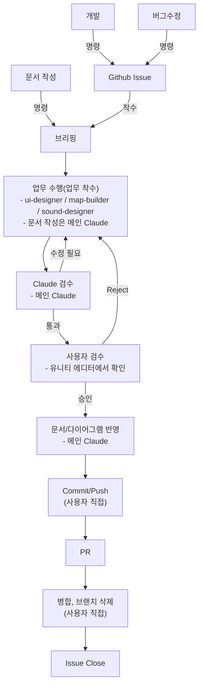

# Workflow 규칙

> 상시 로드 문서. Claude가 업무 수행 시 지켜야 하는 업무 프로세스와 작업 분담, 서브에이전트 운용 방법.
>
> 해당 문서에 기재되지 않은 업무가 발생할 경우, 이 지침에 대한 개선을 사용자에게 권유한다.

---

## 0. 전체 흐름



- 각 단계는 순서대로 진행하며, 이전 단계가 완료되지 않으면 다음 단계로 넘어가지 않는다.
- 현재 어느 단계에 있는지 불분명하면 사용자에게 확인한다.

---

## 1. 업무 유형 분류

- 명령을 받으면 먼저 아래 유형 중 하나로 분류하고, 분류 결과를 사용자에게 알린다.

| 유형 | 내용 | 시작 단계 |
|---|---|---|
| 개발 | Claude 담당 영역(UI, 맵 배치, 사운드, 인스펙터 설정)의 새 작업이나 개선 | `2. Github Issue` |
| 버그수정 | Claude 담당 영역에서 오류 메세지 발생, 예상과 다른 동작 수정 | `2. Github Issue` |
| 문서 작성 | 규칙 문서, 기획 문서, 다이어그램 작성 및 수정 | `3. 브리핑` |

- 분류 전에 `## 작업 분담`에서 담당을 확인한다. 게임 로직 스크립트에 관한 요청이면 사용자 담당 영역임을 알리고, `CLAUDE.md`의 절대 원칙 1번에 따라 원인과 고칠 부분을 안내만 한다.
- 유형이 모호하거나 여러 유형에 걸치는 경우, 임의로 고르지 않고 사용자에게 질문한다.

---

## 2. Github Issue

- 개발, 버그수정 업무 중 이슈로 등록할 필요가 있다고 판단되면 사용자에게 이슈 작성을 권유한다.
- 사용자가 승인하면, 실질적인 작성은 Claude가 수행한다.
- 이슈 등록 권유부터 등록까지의 절차는 `/github-issue` 스킬(`.claude/skills/github-issue/SKILL.md`)을 호출해 수행한다.
- 작성 양식은 `Docs/Template/Issues Template.md`, 섹션별 작성 규칙은 `Docs/Documentation/Github Issue Rule.md`를 따른다.
- 이슈 등록 전, 작성한 내용을 사용자에게 먼저 보여주고 승인을 받는다.
- 등록이 완료되면 이슈 번호를 사용자에게 알리고, 이후 PR에서 이 번호를 사용한다.
- 사용자가 이슈 등록을 원하지 않으면, 이슈 없이 `3. 브리핑`으로 넘어간다.
- 이슈에 착수할 경우, 해당 이슈의 Assignees를 사용자로 지정한다.

---

## 3. 브리핑

- 업무에 착수하기 전, 반드시 작업 계획을 브리핑하고 사용자의 승인을 받는다.
- 브리핑 양식은 `Docs/Claude/ClaudeCodeRules.md`의 "기능 구현 착수 규칙"을 따른다.
- 이슈가 있는 경우, 이슈의 `목표 (To-be)`, `작업 내용`, `완료조건 (DoD)`을 기준으로 작업 계획을 세운다.
- 기존 작업을 수정하거나 연관된 작업을 하는 경우, 아래 문서를 검토한 후 작업 계획을 수립한다.
    - `Docs/TechSpec.md` : 기술 스택 및 구조 결정사항
    - `Docs/Design/GameDesign.md` : 게임 규칙, 수치, 결정 기록
    - 담당 영역 문서 : `Docs/UI/UI.md`, `Docs/World/MapLayout.md`, `Docs/Sound/Sound.md`
    - 그 외 작업과 관련된 `Docs/` 하위 문서 및 다이어그램
- 사용자가 작성한 스크립트와 연결해야 하면, 연결할 필드 이름과 의미를 브리핑에 적고 사용자에게 확인받는다.
- 검토한 문서와 계획이 충돌하면, 브리핑에 충돌 내용을 함께 기재하고 사용자의 결정을 받는다.

---

## 4. 업무 수행 (업무 착수)

- 작업은 업무 유형과 담당 영역에 따라 맡긴다. (`## 서브에이전트 운용`)
    - 개발, 버그수정 : 담당 서브에이전트(`ui-designer`, `map-builder`, `sound-designer`)에 승인된 구현 브리핑을 전달한다.
    - 문서 작성 : 메인 Claude가 승인된 브리핑대로 직접 작성한다.
- 작업은 브리핑에서 승인받은 범위와 순서대로만 진행한다.
- 작업 중 승인받은 범위 밖의 수정이 필요해지면, 작업을 멈추고 사용자에게 보고한 뒤 다시 승인을 받는다.
- 다른 파일에서 문제를 발견하면 보고만 하고 수정하지 않는다.
- 브리핑의 각 단계가 끝날 때마다, 해당 단계의 확인 항목을 점검한다.
- 작업이 끝나면 `6. 사용자 검수` 전에 `5. Claude 검수`를 거친다.

---

## 5. Claude 검수

- 메인 Claude가 작업 결과를 아래 기준과 대조해 "통과" 또는 "수정 필요"로 판정한다.
    - 승인된 브리핑의 범위와 확인 항목
    - `CLAUDE.md`의 절대 원칙, `Docs/Claude/ClaudeCodeRules.md`, `Docs/TechSpec.md`
    - 담당 영역 문서와 `Docs/Design/GameDesign.md`
- 대조할 규칙이 없는 항목은 "규칙 없음"으로 표시한다.
- 판정 이후는 `### 검수 루프`를 따른다.

---

## 6. 사용자 검수

- Claude 검수가 "통과"하면 아래 형식으로 검수를 요청한다.
- "규칙 없음"으로 표시한 항목은 **사용자 확인 필요**에 함께 적는다.

```markdown
## 검수 요청 : [업무명]

**변경 내용**
- 생성 : 파일경로(역할)
- 수정 : 파일경로(변경 내용)
- 삭제 : 파일경로(삭제 사유)

**확인 결과**
- [x] 확인 항목 (확인 방법)
- [ ] 미검증 항목 (미검증 사유)

**사용자 확인 필요**
- 유니티 에디터에서 사용자가 직접 확인해야 하는 항목 (화면 배치, 보기 좋음, 플레이 감각 등)

승인하시겠습니까?
```

- 직접 실행해서 확인하지 못한 항목은 "미검증"으로 표기한다.
- 이슈가 있는 경우, `완료조건 (DoD)` 체크리스트를 기준으로 확인 결과를 작성한다.
- **Reject** : 사용자가 반려하면 반려 사유를 정리해 확인받은 뒤, `4. 업무 수행`으로 돌아간다.
    - 반려 사유가 작업 범위를 벗어나는 경우, `3. 브리핑`으로 돌아가 계획을 다시 세운다.
- **승인** : 사용자가 승인하면 `7. 문서/다이어그램 반영`으로 넘어간다.

---

## 7. 문서/다이어그램 반영

- 이번 업무로 바뀐 결정사항이 있다면, 관련 문서와 다이어그램에 반영한다.
- 반영할 문서와 내용을 먼저 사용자에게 제시하고 승인을 받은 뒤, 메인 Claude가 반영한다.
- 게임 규칙이나 수치가 바뀌었다면 `Docs/Design/GameDesign.md`의 결정 기록에도 날짜와 이유를 함께 남긴다.
- 문서 작성 업무는 `4. 업무 수행`에서 반영을 마쳤으므로 이 단계를 생략한다.
- 규칙 하나는 문서 한 곳에만 적는다. 이미 다른 문서에 있는 내용은 그 문서만 고친다.
- 새 문서를 만든 경우, `CLAUDE.md`의 "규칙 문서 관리" 항목에 따라 등록한다.
- 반영할 내용이 없으면, 없다고 알리고 다음 단계로 넘어간다.

---

## 8. Commit/Push

- 사용자가 직접 수행한다.

---

## 9. PR

- Push가 완료되면 PR을 작성한다. 실질적인 작성은 Claude가 수행한다.
- PR 작성 절차는 `/github-pr` 스킬(`.claude/skills/github-pr/SKILL.md`)을 호출해 수행한다.
- 작성 양식은 `Docs/Template/Pull Request Template.md`를 따른다.
- 이슈가 있는 경우, PR 본문에 이슈를 태그로 연결한다.
- 이슈 기반 업무인 경우, PR이 승인되어 머지될 때 `Closes #00`를 사용해 관련 이슈를 Closed 처리한다.
- PR 등록 전, 작성한 내용을 사용자에게 먼저 보여주고 승인을 받는다.
- PR의 기준 브랜치가 맞는지 사용자에게 확인한다.

---

## 10. 병합, 브랜치 삭제

- 사용자가 직접 수행한다.

---

## 11. Issue Close

- 병합이 완료되면 이슈의 `완료조건 (DoD)`이 모두 충족되었는지 사용자와 함께 확인한다.
- 충족되지 않은 항목이 있으면, 이슈를 닫지 않고 후속 처리 방법을 사용자에게 질문한다.
- 이슈가 없는 업무는 이 단계를 생략한다.

---

## 작업 분담

| 영역 | 담당 |
| --- | --- |
| 게임 로직 스크립트 (1인칭 컨트롤러 포함) | 사용자가 직접 작성 |
| UI/UX (HUD, 조준경, 메뉴, 팝업). UI 스크립트는 초안을 작성하고 사용자가 확인 후 반영 | `ui-designer` |
| 맵 구조물 배치 (거점, 구역, 지형 요소). 배치용 에디터 스크립트 작성 허용 | `map-builder` |
| 사운드 파일 정리와 연결, Audio Mixer, 소리 감쇠 등 인스펙터 조정 (사운드 재생 코드는 사용자) | `sound-designer` |
| 인스펙터 설정 (컴포넌트, 참조 연결, 값) | 각 서브에이전트가 `/inspector-setup` 스킬을 사용 |
| 문서 작성, 검수, 문서 반영 | 메인 Claude |

---

## 서브에이전트 운용

- 에이전트 정의는 `.claude/agents/`에 있으며, 각 에이전트의 입력 조건과 출력 형식은 해당 파일을 따른다.

| 에이전트 | 투입 시점 | 하는 일 | 먼저 읽을 문서 | 쓰는 스킬 |
|---|---|---|---|---|
| `ui-designer` | `4. 업무 수행` (UI 영역) | 화면, HUD, 팝업, 메뉴 구성, UI 스크립트 초안 | `Docs/UI/UI.md` | `/inspector-setup` |
| `map-builder` | `4. 업무 수행` (맵 영역) | 배치도에 따른 구조물과 구역 배치, 배치용 에디터 스크립트 | `Docs/World/MapLayout.md` | `/inspector-setup` |
| `sound-designer` | `4. 업무 수행` (사운드 영역) | 사운드 파일 정리와 연결, Audio Mixer 설정, 소리 감쇠 조정 | `Docs/Sound/Sound.md` | `/inspector-setup` |

- 메인 Claude는 에이전트를 호출하고, 각 에이전트의 산출물을 검수한 뒤 사용자에게 전달한다.
- 작업이 어느 에이전트의 일인지 애매하면 사용자에게 먼저 묻는다.
- 에이전트는 자기 영역 밖의 파일을 고치지 않는다.
- 서브에이전트는 사용자에게 직접 질문하지 않는다. 질문이나 충돌이 생기면 작업을 멈추고 호출자에게 보고한다.
    - 메인 Claude는 보고 내용을 사용자에게 전달하고, 사용자의 결정을 받아 에이전트를 다시 호출한다.

### 검수 루프

- `5. Claude 검수`에서 "수정 필요"로 판정하면, 검수 결과를 요약하지 않고 사용자에게 그대로 전달한 뒤 수정 주체를 질문한다.
    - 사용자가 직접 수정 : 사용자가 수정 완료를 알리면 다시 검수한다.
    - 에이전트에 위임 : 작업한 에이전트에 기존 입력과 검수 결과를 함께 전달해 다시 호출한 뒤, 다시 검수한다.
- 수정이 승인된 브리핑의 범위를 벗어나면, `3. 브리핑`으로 돌아간다.
- 재검수 횟수는 제한하지 않는다. 매 회차마다 수정 주체를 사용자가 정한다.
- 검수가 "통과"하면 다음 단계로 넘어간다.
