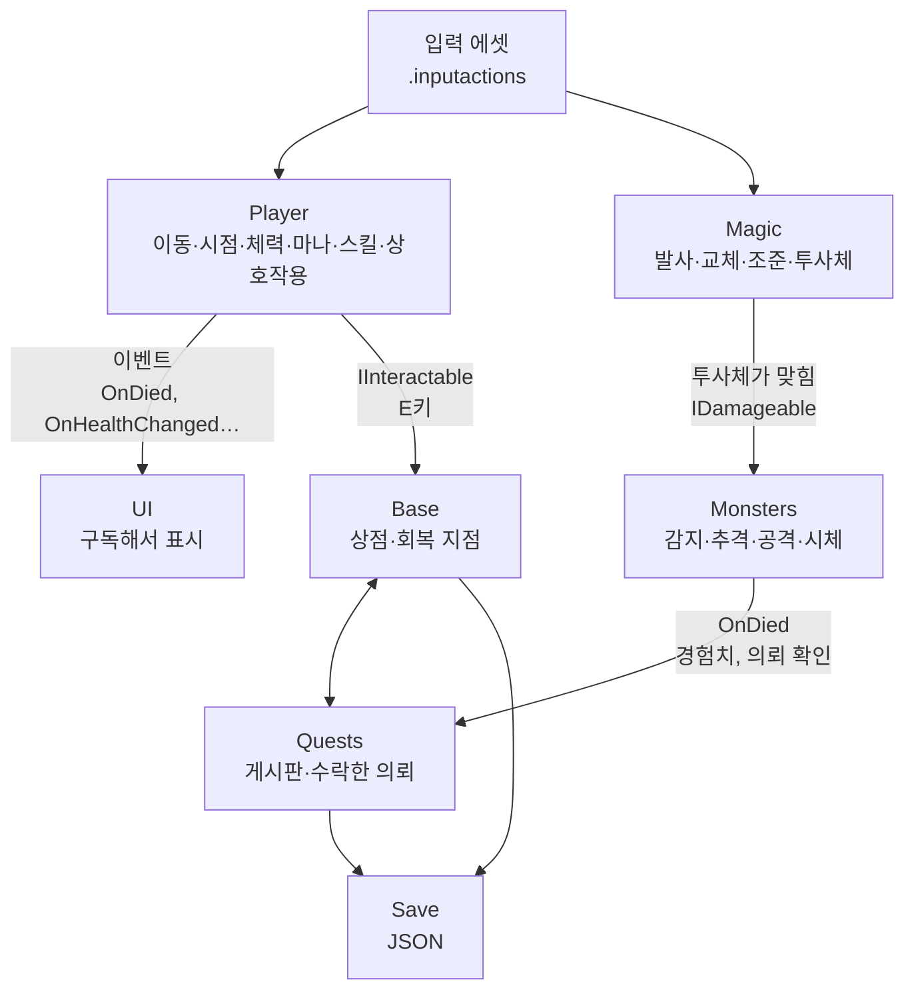

# 스크립트 구조 초안 (Script Structure)

> 작성 : 2026-11-12. 상세화 : 2026-11-13 (폴더별 의존 관계, 패턴 후보, 알고리즘 메모 추가).
> 게임 로직 스크립트를 짜기 전에 참고하는 **초안**이다. 정답이 아니라 출발점이다.
> 스크립트는 사용자가 직접 작성하므로, 이 문서의 이름, 나눈 방식, 연결 방식은 사용자가 따져 보고 고친다.
> 정해진 규칙은 `Docs/TechSpec.md`(폴더 구조, 연결 원칙, 수치 관리), `Docs/Code/code-convention.md`(이름, 작성 규칙), `Docs/Design/GameDesign.md`(게임 규칙)에 있다. 이 문서는 그 규칙을 다시 적지 않는다.

### 이 문서를 읽는 법

- **패턴 후보**는 고를 수 있는 방법을 2개 이상 나란히 적었다. 어느 것이 낫다고 정하지 않았다. 장단점을 보고 직접 고른 뒤, 고른 것과 이유를 `## 5. 생각해 볼 질문`의 결정 칸에 적는다.
- **알고리즘 메모**는 계산의 생각 순서만 적었다. 코드는 넣지 않았다.
- **미정**으로 적은 수치는 `GameDesign.md`에 아직 값이 없는 것이다. 정하면 그 문서에 적는다.
- **결정 필요**로 적은 것은 기획 문서에 없는 방식이다. 쓰기 전에 기획에 넣을지부터 정한다.

---

## 1. 전체 그림

### 공통 약속 (여러 폴더가 함께 쓰는 인터페이스)

| 이름 | 뜻 | 쓰는 곳 (후보) |
|---|---|---|
| `IDamageable` | 맞을 수 있는 것 | 플레이어, 몬스터 |
| `IInteractable` | E키로 상호작용할 수 있는 것 | 시체, 회복 지점, 의뢰서, 상점 |

- 두 인터페이스를 어느 폴더에 둘지는 미정이다 (`## 5. 생각해 볼 질문` 6번).

### 연결 방식 세 가지 (아래 폴더별 설명에서 계속 나온다)

| 방식 | 뜻 | 좋은 점 | 조심할 점 |
|---|---|---|---|
| 직접 참조 | A가 B를 인스펙터로 받아 B의 메서드를 부른다 | 흐름이 눈에 보이고 따라가기 쉽다 | A가 B 없이는 동작하지 않는다. 연결할 곳이 많아지면 인스펙터 연결도 많아진다 |
| 이벤트 (Observer 패턴) | B가 "일이 일어났다"고 알리고, 관심 있는 A가 구독한다 | B는 누가 듣는지 몰라도 된다. 듣는 쪽을 늘리기 쉽다 | 누가 듣고 있는지 코드만 보고는 찾기 어렵다. 구독 해제를 잊으면 오류가 난다 |
| 요청 (TechSpec 연결 원칙) | A가 B에게 "이것 해 줘"라고 부탁하고, 실제로 할지는 B가 정한다 | B의 내부를 A가 건드리지 않는다 | 부탁하는 쪽이 여럿이면 B가 그 요청들을 어떻게 합칠지 정해야 한다 (Player의 시점 잠금 참고) |

---

## 2. 폴더별 상세 (`Assets/Scripts/<기능>/`)

### Player

| 후보 스크립트 | 맡는 일 |
|---|---|
| `PlayerMover` | WASD 이동, 왼쪽 Shift 달리기. 이동 방향은 몸이 바라보는 방향 기준. 중력과 땅에 닿았는지 확인 |
| `PlayerLook` | 마우스 시점 회전. 좌우는 몸을, 위아래는 카메라를 돌린다. 다른 기능이 "시점 회전 꺼 줘"라고 **요청**하는 메서드를 둔다 (TechSpec 연결 원칙) |
| `PlayerHealth` | 체력, `IDamageable`, `OnHealthChanged`, `OnDied`. 체력이 0이 되면 사망 한 번만 알린다 |
| `PlayerMana` | 마나, R키를 누르고 있는 동안 명상 회복, 마법이 마나를 쓰겠다고 요청하면 처리 |
| `PlayerLevel` | 경험치, 레벨업, `OnLevelUp` |
| `PlayerWallet` | 돈. 의뢰비를 받고, 상점이 돈을 쓰겠다고 요청하면 처리 |
| `HealSkill` | G키 회복, 남은 횟수. 회복 지점이 횟수를 되돌리는 메서드를 둔다 |
| `TrackingSkill` | Q키 탐지와 추적. 몇 초 동안 대상 몬스터 방향을 알린다 (표시 시간 미정) |
| `PlayerInteractor` | E키. 바라보는 `IInteractable`을 찾아 실행하고, 바라보는 대상이 바뀌면 알린다 (UI 안내 표시용) |

**의존 관계**

| 스크립트 | 아는 것 (참조) | 알리는 것 (이벤트) |
|---|---|---|
| `PlayerMover` | 입력, 몸 Transform | 없음 (애니메이션이 이동 속도를 읽어 갈 수 있다) |
| `PlayerLook` | 입력, 카메라 | 없음 |
| `PlayerHealth` | 없음 | 체력 바뀜, 사망 |
| `PlayerMana` | 입력 | 마나 바뀜 |
| `PlayerLevel` | 없음 | 경험치 바뀜, 레벨업 |
| `PlayerWallet` | 없음 | 돈 바뀜 |
| `HealSkill` | `PlayerHealth`, 입력 | 남은 횟수 바뀜 |
| `TrackingSkill` | 플레이어 위치, 대상 몬스터 (어떻게 찾을지는 질문 P-4) | 추적 시작, 방향 바뀜, 추적 끝 |
| `PlayerInteractor` | 카메라, 입력 | 바라보는 대상 바뀜 |

**패턴 후보**

| 주제 | 후보 A | 후보 B | 비교할 점 |
|---|---|---|---|
| 기능 나누기 | 기능마다 컴포넌트 하나 (위 표처럼) | `Player` 하나에 모두 넣기 | A는 파일이 많지만 한 파일이 한 가지 일만 한다. B는 처음엔 빠르지만 파일이 커지면 고칠 때 다른 기능을 건드리기 쉽다 |
| 이동 방식 | `CharacterController` | `Rigidbody` | 중력, 경사, 계단을 누가 처리하는가. 몬스터에게 밀리는 일을 어떻게 다룰 것인가 |
| 자원 쓰기 (마나, 돈) | 쓰는 쪽이 "충분한가?"를 먼저 묻고, 그다음 "빼 줘"를 부른다 | 한 번의 요청으로 "충분하면 빼고 성공, 아니면 실패"를 돌려준다 | 두 번 묻는 사이에 값이 바뀔 수 있는가. 실패했을 때 누가 안내를 띄우는가 |
| 체력 표시 | `PlayerHealth`가 UI를 직접 부른다 | UI가 `PlayerHealth`의 이벤트를 구독한다 | 질문 4번과 같은 주제다 |

**알고리즘 메모**

- **시점 회전** : 마우스 이동량에 감도를 곱해 좌우 각도와 위아래 각도에 더한다. 위아래 각도는 고개가 뒤로 넘어가지 않게 범위를 제한한다 (범위 미정). 감도는 설정 값에서 읽는다.
- **시점 잠금 요청을 여러 곳에서 받을 때** : 의뢰 정보 팝업(J)과 맵(M), 일시 정지(ESC)가 모두 잠금을 요청할 수 있다. 아래 세 방법을 비교해 본다.
  - 참/거짓 하나 : 가장 단순하다. 하지만 두 곳이 잠근 뒤 한 곳만 풀어도 풀려 버린다.
  - 잠금 개수 세기 : 잠그면 1 더하고 풀면 1 뺀다. 0일 때만 회전한다. 짝이 안 맞게 부르면 영영 잠기거나 음수가 된다.
  - 요청자 목록 : 누가 잠갔는지 목록에 넣고 뺀다. 같은 곳이 두 번 불러도 한 번으로 친다. 목록을 관리하는 만큼 코드가 늘어난다.
- **명상** : 키를 누른 순간 회복을 시작하고, 뗀 순간 멈춘다. 회복 중에는 매 프레임 `초당 회복량 × 지난 시간`만큼 더하고, 최대 마나를 넘지 않게 자른다 (회복량, 최대 마나 미정). 명상 중 이동 가능 여부는 미정이다.
- **레벨업** : 경험치를 더한 뒤, 필요 경험치를 넘었으면 레벨을 올리고 남는 경험치를 다음 레벨로 넘긴다. 몬스터 한 마리로 두 레벨이 오를 수 있는지에 따라 "한 번만 확인"과 "넘는 동안 반복"이 갈린다 (필요 경험치 표 미정).
- **바라보는 대상 찾기** : 화면 가운데에서 카메라 앞쪽으로 광선을 쏴 처음 맞은 것이 `IInteractable`인지 본다 (최대 거리 미정). 대상이 바뀌었을 때만 알리면 UI가 매 프레임 다시 그리지 않아도 된다.
- **추적 방향** : 대상 위치에서 플레이어 위치를 빼면 방향이 나온다. 높이 차이를 뺀 수평 방향만 쓸지, 카메라가 보는 방향과 몇 도 차이인지로 바꿔서 UI에 넘길지 정한다.

### Magic

| 후보 스크립트 | 맡는 일 |
|---|---|
| `MagicCaster` | 마우스 왼쪽 클릭 발사. 마나 소모를 요청하고, 성공하면 투사체를 꺼낸다. 시전 간격 관리 (마법 다루기 스킬이 시전 속도에 영향) |
| `MagicSelector` | 숫자 키 1~5, 마우스 휠로 교체. 가진 마법만 고를 수 있다. 바뀌면 알린다 |
| `MagicAim` | 마우스 오른쪽 클릭 줌인. 시야각을 배율에 맞게 바꾼다 (배율 미정. 마법 다루기 스킬이 줌인 속도에 영향) |
| `MagicProjectile` | 탄도 (중력 낙차와 비행 시간). 맞힌 대상의 `IDamageable`에 피해를 준다 |

**의존 관계**

| 스크립트 | 아는 것 | 알리는 것 |
|---|---|---|
| `MagicCaster` | `PlayerMana`, `MagicSelector`, 발사 위치, 투사체 풀 | 발사함 (사운드, 애니메이션용) |
| `MagicSelector` | 입력, 가진 마법 목록 (상점에서 산 것) | 마법 바뀜 |
| `MagicAim` | 입력, 카메라, `MagicSelector` | 조준 시작, 조준 끝 |
| `MagicProjectile` | 없음 (맞힌 대상은 그때 찾는다) | 맞힘 (효과, 사운드용) |

**패턴 후보**

| 주제 | 후보 A | 후보 B | 비교할 점 |
|---|---|---|---|
| 판정 방식이 다른 마법 (투사체 / 즉시 판정, 미정) | 판정 방식마다 클래스를 나누고 같은 인터페이스로 부른다 (Strategy 패턴) | 열거형 하나와 `switch`로 나눈다 | 판정 방식이 몇 가지가 될지 모른다. 방식이 늘 때 고칠 곳이 한 군데인가, 여러 군데인가 |
| 마법마다 다른 값 | 마법마다 프리팹을 만들고 인스펙터에 값을 넣는다 | ScriptableObject | 질문 1번과 같은 주제다 (TechSpec의 "별도 데이터 파일" 규칙) |
| 투사체 만들고 지우기 | Unity가 주는 `UnityEngine.Pool.ObjectPool` | 직접 만든 큐(Queue) 풀 | 풀을 쓰는 것은 code-convention에 정해져 있다. 무엇으로 만들지만 고른다. 마법 종류마다 풀을 따로 둘지도 정한다 |
| 투사체 움직이기 | 직접 계산해서 위치를 옮긴다 | `Rigidbody`의 중력과 속도에 맡긴다 | 탄도를 눈으로 미리 그려 보거나 조준 보정을 계산하려면 공식을 알아야 하는가. 물리 엔진의 충돌 감지 옵션을 쓸 수 있는가 |

**알고리즘 메모**

- **탄도** : 매 물리 프레임마다 "속도에 중력 × 지난 시간을 더하고, 위치에 속도 × 지난 시간을 더한다". 두 줄의 순서를 바꾸면 결과가 조금 달라진다. 어느 순서가 더 안정적인지 찾아본다 (찾아볼 말 : 오일러 적분, 반암시적 오일러). 바람과 공기 저항은 넣지 않는다 (GameDesign 3번).
- **뚫고 지나가는 문제** : 질문 2번을 본다. 찾아볼 말 : 터널링(tunneling), 연속 충돌 감지(Continuous Collision Detection), 이전 위치와 다음 위치 사이 검사.
- **투사체 수명** : 아무것도 맞히지 않은 투사체를 언제 풀로 돌려보낼지 정한다. 시간 기준과 거리 기준이 있다 (값 미정).
- **휠로 마법 교체** : 다음 번호로 넘어가다 끝에 닿으면 처음으로 돌아간다 (찾아볼 말 : 나머지 연산으로 순환). 갖지 않은 마법 칸은 건너뛸지, 휠은 가진 마법만 순서대로 돌지 정한다.
- **줌인** : 시야각을 목표 값까지 바꾸는 방법으로 `Lerp`, `MoveTowards`, `SmoothDamp`가 있다. 각각 "속도가 일정한가, 끝에서 느려지는가, 정확히 도착하는가"를 비교해 본다. 줌인 속도 스킬은 이 속도 값에 곱해진다.

### Monsters

| 후보 스크립트 | 맡는 일 |
|---|---|
| `Monster` | 체력, `IDamageable`, `OnDied`. 몬스터 종류 (의뢰 대상 확인용) |
| `MonsterSenses` | 감지 거리, 피격 시 감지 거리, 은신에 따른 감지 확률. "플레이어를 감지했다"를 알린다 |
| `MonsterBrain` | 상태 전환 (대기 → 추격 → 공격 → 사망) |
| `MonsterCorpse` | 시체 확인 (`IInteractable`). 한 번만 확인되게 한다 |
| `MonsterSpawner` | 서식지 배치, 처치 10분 뒤 다시 나옴 (임시값). 게임을 켤 때 모두 새로 배치 |

**의존 관계**

| 스크립트 | 아는 것 | 알리는 것 |
|---|---|---|
| `Monster` | 없음 | 맞음, 사망 |
| `MonsterSenses` | 플레이어 위치, 은신 스킬 수준 (어디서 읽을지는 질문 5번), `Monster` (맞았는지) | 감지함 |
| `MonsterBrain` | `Monster`, `MonsterSenses`, 플레이어 | 상태 바뀜 (애니메이션용) |
| `MonsterCorpse` | `Monster` (종류) | 시체 확인됨 (의뢰, 경험치 확인용) |
| `MonsterSpawner` | 서식지 위치, 몬스터 프리팹 | 없음 |

**패턴 후보**

| 주제 | 후보 A | 후보 B | 비교할 점 |
|---|---|---|---|
| 상태 관리 | 열거형 + `switch` 하나 | 상태마다 클래스를 나누고 들어갈 때, 있는 동안, 나갈 때를 각각 둔다 (State 패턴) | 상태가 4개일 때와 10개일 때 각각 어느 쪽이 읽기 쉬운가. "들어갈 때 한 번만" 할 일을 어디에 적는가 |
| 추격 이동 | NavMesh (길 찾기) | 플레이어 쪽으로 곧장 이동 | **결정 필요**. 기획 문서에 길 찾기 방식이 없다. 지형 높낮이와 바위가 많은 맵에서 곧장 이동이 버틸 수 있는가 |
| 경험치, 의뢰 연결 | 몬스터가 죽을 때 `PlayerLevel`과 `QuestLog`를 직접 부른다 | 몬스터는 알리기만 하고, `PlayerLevel`과 `QuestLog`가 구독한다 | 몬스터 프리팹이 수십 개일 때 인스펙터 연결은 누가 하는가. 구독할 대상(새로 나온 몬스터)을 어떻게 아는가 |
| 다시 나오기 | 죽은 몬스터를 지우고 새로 만든다 | 꺼 두었다가 다시 켠다 (풀) | 다시 켤 때 체력, 상태, 위치를 무엇까지 처음으로 돌려야 하는가 |

**알고리즘 메모**

- **상태 전환 표** : 각 상태에서 어떤 조건이면 어디로 가는지 표로 먼저 그려 본다. 예를 들어 "대기에서 감지하면 추격", "추격에서 가까워지면 공격", "어느 상태든 체력 0이면 사망". 놓치기 쉬운 칸은 "추격 중에 플레이어가 아주 멀어지면?"이다 (기획 문서에 없다. 결정 필요).
- **거리 비교** : 거리끼리 비교만 할 때는 제곱한 값끼리 비교해도 결과가 같다. 제곱근 계산을 아끼는 방법이다 (찾아볼 말 : `sqrMagnitude`).
- **감지 확인 간격** : 몬스터마다 매 프레임 확인할지, 몇 번에 한 번만 확인할지 정한다. 몬스터 수가 많을 때 차이가 난다.
- **맞았을 때 감지** (GameDesign 3번 표) : 먼저 거리가 피격 시 감지 거리 안인지 본다. 안이면 "기본 100% − 은신 감소값"을 확률로 쓰되 50% 밑으로 내려가지 않게 자른다. 0~1 사이 난수를 뽑아 확률보다 작으면 감지한다.
- **시야 가림** : 바위 뒤에 있는 플레이어도 감지하는가? 기획 문서에는 거리만 있다 (결정 필요).
- **다시 나오는 시간** : "게임 중에만 시간이 흐름"이 규칙이다. 시계 시각을 기록하는 방법과 남은 시간을 매 프레임 줄이는 방법이 있다. 일시 정지(시간 배율 0) 동안 어느 쪽이 멈추는지 확인해 본다.

### Quests

| 후보 스크립트 | 맡는 일 |
|---|---|
| `QuestBoard` | 게시판 5자리. 자리마다 의뢰가 붙어 있거나, 비어 있고 남은 시간이 있다. 시간이 다 되면 새 의뢰를 랜덤으로 채운다 (시간은 임시값) |
| `QuestNote` | 의뢰서 한 장 (`IInteractable`). 확인, 수락, 줌아웃 |
| `QuestLog` | 수락한 의뢰 (최대 3). 시체를 확인하면 대상이 맞는지 보고 완료, 의뢰비 지급 요청 |

**의존 관계**

| 스크립트 | 아는 것 | 알리는 것 |
|---|---|---|
| `QuestBoard` | 의뢰 후보 목록, 거점 위치 (방향 계산용) | 자리 바뀜 |
| `QuestNote` | `QuestBoard` (자기 자리), `QuestLog` (수락) | 확인 시작, 확인 끝 (줌인, 시점 잠금용) |
| `QuestLog` | `PlayerWallet` | 의뢰 수락, 의뢰 완료 |

**패턴 후보**

| 주제 | 후보 A | 후보 B | 비교할 점 |
|---|---|---|---|
| 의뢰 한 건의 모양 | 값만 담은 작은 클래스 (대상 종류, 의뢰비, 방향, 이름, 설명) | 의뢰서 오브젝트(`QuestNote`)가 직접 값을 가진다 | 저장할 때 무엇을 JSON으로 바꾸기 쉬운가. 게시판에서 떼어 `QuestLog`로 옮길 때 무엇이 옮겨 가는가 |
| 완료 확인 | `MonsterCorpse`가 `QuestLog`를 부른다 | `QuestLog`가 시체 확인 이벤트를 구독한다 | Monsters의 "경험치, 의뢰 연결"과 같은 고민이다. 같은 방식으로 맞출지 정한다 |

**알고리즘 메모**

- **자리별 타이머** : 빈자리마다 남은 시간을 갖고, 매 프레임 지난 시간만큼 줄인다. 0 이하가 되면 새 의뢰를 채운다. 저장 규칙이 "자리별 남은 시간"이므로 남은 시간을 그대로 저장하고 불러오면 된다.
- **랜덤 채우기** : 후보 목록에서 하나를 고른다. 이미 붙어 있거나 수락한 의뢰와 같은 것이 또 나와도 되는지 정한다 (기획 문서에 없다. 결정 필요).
- **거점 기준 방향 (예 : 북동, 남서)** : 대상 서식지 위치에서 거점 위치를 빼서 수평 방향을 구하고, 그 방향의 각도를 구한다 (찾아볼 말 : `Atan2`). 360°를 8칸(한 칸 45°)으로 나눠 이름을 붙인다. 생각할 점 : 어느 축이 북쪽인가 (맵 배치도 기준), 칸 경계(예 : 정확히 22.5°)는 어느 칸에 넣는가, 서식지가 여러 곳인 몬스터는 어느 위치를 쓰는가.
- **같은 종류 의뢰 두 개** : 수락한 의뢰 두 개가 같은 몬스터 종류라면, 시체 하나로 둘 다 완료되는가? (기획 문서에 없다. 결정 필요)

### Base

| 후보 스크립트 | 맡는 일 |
|---|---|
| `MagicShop` | 마법 구매 (`IInteractable`). 가진 돈과 가격을 비교해 구매하고, 산 마법을 가진 마법 목록에 넣는다 |
| `HealingPoint` | 회복 남은 횟수 초기화 (`IInteractable`) |

- 의존 : `MagicShop`은 `PlayerWallet`과 가진 마법 목록을, `HealingPoint`는 `HealSkill`을 안다.
- 생각할 점 : "가진 마법 목록"은 누가 가질까? `MagicSelector`, `MagicShop`, 저장이 모두 이 목록을 쓴다 (질문 B-1).

### Save

| 후보 스크립트 | 맡는 일 |
|---|---|
| `SaveData` | 저장할 값 묶음 (TechSpec "저장" 목록) |
| `SaveSystem` | JSON 읽고 쓰기, 사망 후 나갈 때 삭제 |
| `SettingsStorage` | 설정 값 (마우스 감도, 소리 크기) 따로 저장 |

**패턴 후보**

| 주제 | 후보 A | 후보 B | 비교할 점 |
|---|---|---|---|
| 값 모으기 | `SaveSystem`이 모든 기능을 알고 직접 값을 읽어 온다 | 저장할 기능마다 "내 값을 줘 / 이 값으로 돌아가"를 맡는 인터페이스를 붙이고, `SaveSystem`은 그 인터페이스 목록만 안다 | A는 한 파일에서 전부 보인다. B는 저장할 기능이 늘어도 `SaveSystem`을 고치지 않는다 |
| 저장 데이터 모양 | 값만 담은 클래스 묶음 (게임 오브젝트를 넣지 않는다) | 기능 클래스를 그대로 저장 | `MonoBehaviour`를 JSON으로 바로 바꿀 수 있는가. 저장 파일을 열어 사람이 읽을 수 있는가 |
| JSON 도구 | `JsonUtility` (Unity 기본) | Newtonsoft Json (패키지 추가) | `JsonUtility`는 `Dictionary`와 프로퍼티를 저장하지 못한다. 패키지 추가는 TechSpec 결정이 필요하다 |
| 설정 저장 | `PlayerPrefs` | 별도 JSON 파일 | 사망 때 게임 저장만 지우고 설정은 남겨야 한다 (TechSpec). 둘 다 이 조건을 지킬 수 있는지 본다 |

**알고리즘 메모**

- **저장 위치** : 빌드에서도 쓸 수 있는 폴더를 써야 한다 (찾아볼 말 : `Application.persistentDataPath`).
- **쓰다가 꺼지면?** : 2026-11-13에 Unity가 씬을 저장하다 꺼져서 씬 파일이 반쯤만 쓰인 일이 있었다. 게임 저장 파일도 쓰는 도중에 꺼지면 같은 일이 생긴다. 찾아볼 말 : 임시 파일에 먼저 쓰고 바꿔치기, 백업 파일.
- **불러오는 순서** : 불러온 값을 넣기 전에 각 기능의 `Awake`/`Start`가 끝나 있어야 하는가? 순서가 꼬이면 처음 값이 불러온 값을 덮어쓴다.
- **열거형 저장** : 몬스터 종류, 마법 종류를 저장한다면 code-convention의 "저장하는 열거형은 값을 명시한다"를 따른다.

### UI (참고)

- UI는 Claude(`ui-designer`) 담당이다. 구조는 `Docs/UI/UI.md`를 따른다 (작성 예정).
- 게임 로직 쪽에서 정할 것은 "UI가 무엇을 읽어 가고, 무엇을 알림받는가"다. 위 폴더별 "알리는 것" 열이 그 목록의 초안이다.

---

## 3. 게임 전체 상태 (질문 3번의 후보)

폴더 목록에 "게임 멈춤과 사망을 누가 관리하나"를 맡을 자리가 없다. 정하기 전에 아래를 비교해 본다.

| 주제 | 후보 A | 후보 B | 비교할 점 |
|---|---|---|---|
| 어디서든 찾기 | 싱글톤 (`Instance`로 어디서든 접근) | 인스펙터로 필요한 곳에만 연결 | A는 연결이 편하다. 하지만 누가 쓰는지 숨겨지고, 씬을 다시 열거나 테스트할 때 남은 값이 문제가 될 수 있다 |
| 상태 표현 | 열거형 하나 (플레이 중, 맵, 일시 정지, 사망) | 상태마다 클래스 (State 패턴, Monsters와 같은 고민) | 상태끼리 겹칠 수 있는가? 예 : 의뢰 팝업(J)은 게임을 멈추지 않지만 시점을 잠근다 |
| 멈추기 | 시간 배율을 0으로 만든다 | 기능마다 "멈춤" 상태를 직접 확인한다 | 시간 배율 0이면 무엇이 멈추고 무엇이 계속 도는가 (`Update`는 돈다. 지난 시간은 0이 된다. UI 애니메이션과 입력은?) |

- 멈추는 화면 : 맵(M), 일시 정지(ESC). 멈추지 않는 화면 : 의뢰 정보 팝업(J). 의뢰서 줌인은 기획 문서에 멈춤 여부가 없다 (결정 필요).

---

## 4. 여러 폴더에 걸친 메모

- **이벤트 구독과 해제** : code-convention의 "이벤트" 항목을 따른다. 여기서는 다시 적지 않는다.
- **몬스터처럼 나중에 생기는 오브젝트의 이벤트** : 씬에 처음부터 있는 오브젝트는 `OnEnable`에서 구독하면 된다. 나중에 생기는 몬스터는 누가 구독시켜 줄까? 후보 : 스포너가 만들 때 연결한다, 정적(static) 이벤트로 모두가 한 곳에 알린다. 정적 이벤트는 편하지만 "어느 몬스터인지"를 함께 넘겨야 한다.
- **입력 끄기** : 시점 잠금 말고도 "사격 안 됨"(J 팝업)이 있다. 입력 액션을 끄는 방법과, 각 기능이 잠금 상태를 확인하는 방법을 비교한다.
- **매 프레임 할 일 줄이기** : 감지, 바라보는 대상 찾기처럼 매 프레임 할 필요가 없는 일은 간격을 둘 수 있다. 간격을 두면 반응이 늦어지는 것과 맞바꾼다.

---

## 5. 생각해 볼 질문

구조를 확정하기 전에 직접 판단할 것들이다. 답을 정하면 이 문서에 결정과 이유를 적는다.

### 처음 정한 질문

1. **마법 데이터를 어디에 둘까?**
    - TechSpec에 "별도 데이터 파일은 만들지 않는다"는 규칙이 있다. ScriptableObject는 이 규칙에 걸릴까?
    - 걸린다면, 마법마다 다른 값 (탄속, 마나 소모, 줌 배율)을 어떻게 구분할까? (힌트 : 마법마다 프리팹)
2. **빠른 투사체가 얇은 몬스터를 뚫고 지나가면?**
    - 한 프레임에 이동하는 거리가 몬스터 두께보다 크면 충돌을 놓칠 수 있다. 어떻게 막을까?
3. **게임 멈춤 (M, ESC)과 사망은 누가 관리할까?**
    - 폴더 목록에 "게임 전체 상태"를 맡을 자리가 없다. 새 폴더를 만들까, 기존 폴더에 넣을까? (`## 3. 게임 전체 상태` 참고)
4. **`PlayerHealth`가 UI를 직접 알아야 할까, UI가 이벤트를 구독해야 할까?**
    - 각 방식에서 어느 쪽이 어느 쪽을 몰라도 되는지 생각해 본다.
5. **스킬 수준 (마법 다루기, 은신)은 어디에 둘까?**
    - 쓰는 곳 (`MagicAim`, `MonsterSenses`)과 저장하는 곳 (`SaveData`)이 다르다.
6. **공통 인터페이스 (`IDamageable`, `IInteractable`)는 어느 폴더에 둘까?**

### 폴더별 추가 질문

| 번호 | 질문 |
|---|---|
| P-1 | 이동에 `CharacterController`와 `Rigidbody` 중 무엇을 쓸까? 몬스터에게 밀려야 하는가? |
| P-2 | 시점 잠금 요청을 참/거짓, 개수 세기, 요청자 목록 중 무엇으로 받을까? |
| P-3 | 마나와 돈을 쓸 때 "확인 후 빼기"와 "한 번에 시도" 중 무엇으로 할까? |
| P-4 | 수락한 의뢰가 여러 개일 때, 탐지와 추적(Q)은 어느 몬스터를 가리킬까? 대상 몬스터는 어떻게 찾을까? |
| M-1 | 판정 방식이 다른 마법을 Strategy 패턴과 `switch` 중 무엇으로 나눌까? |
| M-2 | 투사체를 직접 계산할까, `Rigidbody`에 맡길까? |
| M-3 | 투사체 풀을 마법 종류마다 따로 둘까? |
| MO-1 | 몬스터 상태를 열거형 + `switch`로 할까, State 패턴으로 할까? |
| MO-2 | 추격에 NavMesh를 쓸까? (기획 결정 필요) |
| MO-3 | 감지에 시야 가림을 넣을까? 플레이어가 멀어지면 추격을 멈출까? (기획 결정 필요) |
| MO-4 | 몬스터의 사망, 시체 확인을 경험치와 의뢰에 어떻게 연결할까? (직접 호출, 구독, 정적 이벤트) |
| Q-1 | 게시판에 같은 의뢰가 두 번 붙어도 되는가? 같은 종류 의뢰 두 개는 시체 하나로 둘 다 완료되는가? (기획 결정 필요) |
| Q-2 | 거점 기준 방향에서 북쪽은 어느 축이고, 칸 경계는 어디에 넣을까? |
| Q-3 | 의뢰서 줌인 중에는 게임이 멈추는가? (기획 결정 필요) |
| B-1 | "가진 마법 목록"은 어느 스크립트가 가질까? |
| S-1 | 저장할 값을 `SaveSystem`이 직접 모을까, 인터페이스로 모을까? |
| S-2 | JSON 도구와 설정 저장 방식은 무엇으로 할까? |
| S-3 | 저장 도중 꺼졌을 때 파일이 깨지지 않게 할까? 한다면 어떻게? |

### 결정 기록

| 날짜 | 질문 번호 | 결정 | 이유 |
|---|---|---|---|
|  |  |  |  |

---

## 6. 구현 순서

- `Docs/Design/GameDesign.md` 8번 "구현 단계" 표에서 사용자가 정한다.
- 참고 : 같은 문서에 "저격 탄도는 넓은 월드가 없어도 시험장 하나에서 먼저 만들어 볼 수 있다"는 힌트가 있다. **이동과 시점 → 발사와 탄도 → 맞는 표적** 중 무엇이 가장 큰 위험을 먼저 확인시켜 줄지 생각해 본다.
